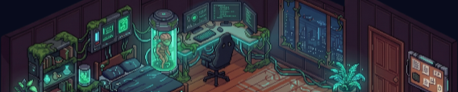

<!-- Profile README for github.com/Seifpetit. Put this file and banner.png in a public repo named Seifpetit/Seifpetit. -->
<!-- 

  

-->

<h1 align="center">Hi, I'm Seif Jlassi 👋</h1>

  <b>I build interaction-heavy tools, custom editors and spatial interfaces.</b> 
  Focused on clarity, workflow and automation. Based in Dortmund, Germany.

  

<!-- Add your own links here, for example LinkedIn and email, as more badges in the paragraph above. -->

---

## What I do

- 🧰 **Tools people actually use:** editors, dashboards and automations that turn a messy workflow into a few clicks.
- 🗺️ **Spatial and interactive systems:** canvas scenes, pathfinding, hotspots and animation that react to the visitor.
- 🧭 **Clarity first:** every screen has one job, and what it does is obvious in seconds.

## Featured: my portfolio is a room you walk through

<table>
  <tr>
    <td width="62%">
      <a href="https://github.com/Seifpetit/Portfolio-room"><b>Portfolio-room</b></a> is a pixel-art room with a capybara in
      a teal hoodie. Click the floor and he walks there. The tech lab opens my projects, the desk my CV, the corkboard my
      contact links.  
      It's built from plain JavaScript and canvas, with a local editor of my own for the content, the zones he can walk
      to, and the floor itself. The site speaks 4 languages.  
      <a href="https://seifpetit.github.io/Portfolio-room/">▶ Open the live room</a> ·
      <a href="https://github.com/Seifpetit/Portfolio-room">Source code</a>
    </td>
    <td width="38%" align="center">
      
    </td>
  </tr>
</table>

## Tools I work with

---

<i>Building interaction-heavy tooling, custom editors, and spatial systems.</i>

